# 第 4 课：让同一会话优先使用同一个上游

**本课独立代码：[lessons/04-session-affinity](../lessons/04-session-affinity/README.md)。**先在仓库根目录执行 `cd lessons/04-session-affinity`。本课累计第 3 课的容量、超时与取消机制，只使用标准库，没有数据库或 worker。

## 为什么按请求均衡还不够？

第 2 课的共享 `cursor` 会让同组请求轮转；第 3 课优先选择占用比例最低的端点，负载相同时仍然轮转。它们都没有判断两个请求是否来自同一个会话。

假设上游 A、B 都空闲，用户在同一会话中依次问三个问题。旧策略可能选择 `A → B → A`，其他用户的请求也会推进轮转游标。对于每次都携带完整消息历史的 Chat Completions 请求，换上游通常不妨碍继续生成，但可能改变回答风格、实际模型和缓存命中情况。

`Gateway` 是进程内共享的路由器：前台请求共用它，下一课加入的后台 worker 也会共用它。共享连接池、容量和锁有利于统一管理资源。改成每个用户创建一个 `Gateway`，会使同一个供应商的容量被分别计算，反而可能超卖。

这课给共享路由器加一条规则：**同一会话、同一档次优先使用同一个 `Provider + Model`；首选满载或故障时允许临时 fallback。**这称为软粘性，不承诺每次都落在同一上游。

## 先看图：固定首选，有容量才占位



[查看 Mermaid 源图](diagrams/04-session-affinity.mmd)

哈希计算只决定“优先去哪儿”。检查容量与增加在途计数仍在同一个短锁内完成，不拿着锁调用供应商。首选在途数更高但尚未满载时，也会优先使用；软粘性为会话稳定性让出一部分实时负载均衡能力。

| 条件 | 本课选择规则 |
| --- | --- |
| 没有会话标识 | 保留第 3 课的占用比例选择，并列时轮转 |
| 首选有容量，且本次调用尚未尝试 | 使用首选，不因其他候选更空闲而切换 |
| 首选满载 | 在当前组内按负载选择其他有容量的候选 |
| 首选出现允许重试的错误 | 本次调用尝试当前组内其他候选 |
| 当前组没有可尝试且有容量的候选 | 进入下一组，重新确定该组首选 |
| 全部候选都满载 | 返回 503，不创建等待队列 |
| 已开始输出 SSE | 保持现有规则：失败时中止响应，不再切换 |

普通 4xx 仍然直接返回错误；408、429、5xx 和允许重试的网络/读取错误遵循前面课程的有限 fallback。每个 Target 在一次调用中最多尝试一次，总时限与单候选时限继续生效。

## 请求中的会话标识从哪里来？

请求新增一个可选的网关扩展字段：

```json
{
  "model": "balanced",
  "gateway_session": "tenant-1/user-2/session-3",
  "messages": [{"role": "user", "content": "介绍一下 Go"}]
}
```

调用方在会话开始时创建稳定标识，后续轮次继续使用。示例把租户、用户和会话放在一起，避免不同用户各自使用 `session-1` 时共用同一键；实际也可以使用全局唯一、无个人信息的随机会话 ID。不要每次请求生成新值，也不要仅用用户 ID，否则该用户的所有会话会粘在一起。

`gateway_session` 是可选的非空白字符串，最多 256 个 UTF-8 字节。省略表示普通负载均衡；显式传 `null`、空串、纯空白、其他类型或过长值返回 400。标识原样参与哈希，不做大小写转换或去除首尾空格。JSON 和 SSE 使用同一套路由键，`stream` 不参与选择。

这里的标识由调用方提供，**用于路由，不用于鉴权**。现有 `GATEWAY_TOKEN` 是共享令牌，并不识别真实用户或租户。接入按用户鉴权后，应由可信业务层构造带命名空间的会话键，不能仅凭这个字符串声称已经实现租户隔离。

## 沿代码走一遍：解析、哈希、占位、发送

### 1. ParseRequest 保留会话字段，供网关和后续持久化使用

[types.go](../lessons/04-session-affinity/internal/gateway/types.go) 在 `Request` 中增加 `Session string`，从原始 JSON 的 `gateway_session` 解析并校验。`Fields` 仍保留原始字段。

为什么不直接从 `Fields` 删除它？下一课的异步提交会保存原始请求，worker 再解析请求。保留这个字段，就能让前台和后台使用同一会话键，不需要新增数据库列。会话键不是会话消息存储，网关不会自动补齐历史消息。

### 2. 用稳定哈希确定组内首选

[affinity.go](../lessons/04-session-affinity/internal/gateway/affinity.go) 的 `sessionTarget` 使用 rendezvous hashing，也称最高随机权重哈希：为组内每个候选分别计算分数，选择分数最高的候选。

```go
key, _ := json.Marshal([]string{r.Session, r.Tier, target.Provider, target.Model})
score := sha256.Sum256(key)
```

这里的 `json.Marshal` 编码的是字符串数组，不是任意业务对象，因此不存在不可编码的字段；JSON 数组给各字符串提供明确边界，避免简单拼接产生歧义。`sha256.Sum256` 返回固定长度的字节数组，`bytes.Compare` 按字节顺序比较分数。

分数包含逻辑档次和真实 Target。同一个 session 换档次时，可以有不同首选；同组映射多个真实模型时，绑定的是 `Provider + Model`，而不只是供应商名字。分数极少相同时，再按供应商名和模型名决定，避免依赖候选顺序。

为什么不用 `hash(session) % len(group)`？它也能固定首选，但改变候选数量会让大量会话重分配。最高随机权重为每个 Target 单独计算分数：加入候选时，只有新候选分数超过旧首选的会话会迁移；删除候选时，原先以它为首选的会话会改选。配置变化仍然可能导致缓存需要重新预热。

这个实现不维护 session 到上游的 map，因此不需要管理不断增长的绑定表、过期和清理。它不依赖进程随机种子、共享 cursor 或 map 遍历顺序。相同会话键、档次、算法和 Target 集合，在重启或另一个网关实例上也能计算出相同首选。多实例的端点配置和凭据对应关系也应保持一致；实际选择仍会因各实例看到的容量或故障而不同。本课的容量计数仍是进程内计数，没有实现分布式配额。

### 3. acquire 在共享容量内优先使用首选

[router.go](../lessons/04-session-affinity/internal/gateway/router.go) 的 `Do` 进入每个候选组时，先在锁外计算首选，再传给 `acquire`。`acquire` 持锁检查候选：

```go
if tried[t] || b.active >= b.capacity {
    continue
}
if t == preferred {
    chosen, selected = t, b
    break
}
```

首选可用就选中它，否则继续使用第 3 课的占用比例比较。没有 session 时，`sessionTarget` 返回空 Target；配置不允许空供应商名和模型名，所以不会命中首选分支，原有负载均衡继续工作。

`tried` 仍是每次 `Do` 新建的局部 map；`cursor` 和在途计数仍属于共享 `Gateway`。选中与占位在同一临界区，流式槽位仍保留至响应体关闭。粘性不能绕过容量限制。

### 4. Provider.Open 移除网关字段

[provider.go](../lessons/04-session-affinity/internal/gateway/provider.go) 复制 `Fields` 并替换真实 `model` 时，跳过 `gateway_session`。它不是供应商协议参数，不应让上游因未知字段拒绝请求。

原始 `Fields` 不会被修改，因而失败后换候选，以及下一课的持久化，都能继续读取同一个 session。其他协议字段仍透传，包括调用方提供的 `prompt_cache_key`；供应商是否支持这些字段仍由调用方与配置负责。

## 临时 fallback 后，下次请求去哪里？

假设 session S 的首选是 A。第一次请求 A 成功，第二次 A 满载而临时用了 B，第三次 A 已有空位：

```text
第一次：S → A
第二次：S → A 满载 → B
第三次：S → A
```

本课不因为一次 fallback 改写绑定，也没有存储“上次成功上游”。这是固定首选的软粘性：实现简单、无绑定表、跨重启稳定，但故障期间每个新请求仍可能先尝试 A。熔断、fallback 成功后重新绑定、带 TTL 的绑定表和跨实例共享状态，留作后续扩展。

## 粘性路由与缓存是什么关系？

固定 `Provider + Model` 可以减少由网关主动切换上游造成的缓存冷启动；它不保证命中缓存。提示前缀变化、缓存到期、账号或工作空间变化，以及供应商内部的路由，都可能影响命中。固定一个供应商 API 地址，也不等于固定它内部的一台推理机器。具体规则需要参考供应商文档，例如 [OpenAI Prompt Caching](https://developers.openai.com/api/docs/guides/prompt-caching)。

本地 Mock 没有模型前缀缓存。本课实验验证的是选择规则、容量和协议边界，不拿 Mock 的结果推断真实缓存收益。客户端仍需发送完整消息历史，并确保 fallback 模型支持请求中的工具与多模态参数。

## 运行与观察

先按[本课 README](../lessons/04-session-affinity/README.md)启动三个 Mock 和网关。在新的终端进入本课目录，连续执行三次：

```sh
for round in 1 2 3; do
  curl -sS -i http://localhost:8080/v1/chat/completions \
    -H 'Content-Type: application/json' \
    -d '{"model":"balanced","gateway_session":"tenant-1/user-2/session-3","messages":[{"role":"user","content":"介绍一下 Go"}]}'
done
```

上游均正常且有容量时，响应头 `X-Gateway-Provider` 和 `X-Gateway-Model` 应保持一致。改成多个不同会话键，多次观察整体分散；不同键允许碰巧选中同一个上游，并不保证两个会话一定分开。删除 `gateway_session`，恢复按负载选择与并列轮转。

再运行确定性的边界测试：

```sh
go test -v ./internal/gateway -run TestSession
go test -race ./...
```

测试会保持流式响应体打开，验证首选尚有容量时不会因为别的上游更空闲而切换；首选满载才用其他候选，全部满载返回 `ErrBusy`。关闭首选上的流后，新请求应回到原上游。另有测试覆盖 429/500 的临时 fallback、400 不切换、每个候选最多一次、候选顺序改变与新实例的一致性，以及 HTTP JSON/SSE 的 session 稳定和网关字段不泄漏。

没有 session 的已有测试也必须继续通过，证明新能力没有改变普通请求的负载均衡、流输出后的 fallback 边界或取消释放。

下一步：[第 5 课：持久化后台任务](05-jobs.md)。会话键将随任务正文保存，worker 使用同一套路由；任务的重启恢复与至少一次执行是下一课的问题。
